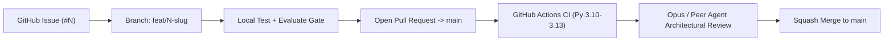

# AGENTS.md — Multi-Agent Collaboration Guide (`mcp-flow`)

This repository is designed for collaborative development by multiple AI coding agents (**OpenAI Codex Cloud**, **Claude Code / Opus**, **GitHub Copilot SWE Agent**, **Google Jules**, and **Antigravity**) alongside human developers.

Before writing code, creating a branch, or opening a Pull Request, read [docs/design.md](docs/design.md) and follow every rule in this file.

---

## 1. Non-Negotiable Architecture & Security Invariants

1. **Passive Observation Only**:
   - Never add active vulnerability scanning, fuzzing payloads, or traffic-blocking gateway behavior.
2. **Zero External Core Dependencies**:
   - Everything under `src/mcp_flow/` MUST run on **Python 3.10+ standard library only** (`dependencies = []` in `pyproject.toml`). Optional integrations belong in `[project.optional-dependencies]`.
3. **Zero-Mutation Proxy Relay**:
   - `proxy/` must forward raw JSON-RPC bytes without altering a single byte or blocking I/O.
4. **Immutable Raw Log & Recomputable Derived Layers**:
   - `messages` is append-only primary data.
   - `calls`, `fragments`, `flows`, and rule-based `labels` are derived data that must be 100% recomputable from `messages` via `mcp-flow analyze <session>`.
5. **Epistemic Honesty (Observation vs. Causation)**:
   - Every report, graph output, and MCP response must preserve the disclaimer (`OBSERVATION_DISCLAIMER`) stating that edges represent **observed content correlation**, not proof of internal LLM causal reasoning.
6. **Local-Only & `0600` Permissions**:
   - Never transmit trace data over the network. SQLite database files must always enforce `0600` (`stat.S_IRUSR | stat.S_IWUSR`) permissions.
7. **Default Non-Disclosure in Read-Only MCP Server**:
   - `src/mcp_flow/server/mcp_server.py` must NEVER return raw fragment `text` unless `expose_text=True` (`--expose-text`) is explicitly set.

---

## 2. Branching Model & Pull Request Workflow

`main` is a **protected branch**. Direct pushes and force-pushes to `main` are disabled. All changes must go through a feature branch and a Pull Request.



### Branch Naming Conventions
When starting work on an issue or task, branch off the latest `main`:

- `feat/<issue-number>-<short-slug>` — New features or milestone extensions (e.g., `feat/1-wrap-config`)
- `fix/<issue-number>-<short-slug>` — Bug fixes or false-positive reductions
- `eval/<issue-number>-<short-slug>` — New synthetic scenarios or evaluation harness improvements
- `docs/<issue-number>-<short-slug>` — Design docs or usage documentation
- *(Note: Auto-generated cloud agent branches such as `codex/...`, `copilot/...`, or `claude/...` are also accepted as long as they target `main` and reference the Issue number in the PR body.)*

### Modular Extension Rules (Preventing Merge Conflicts Between Parallel Agents)
Multiple agents may work on different branches simultaneously. Minimize cross-file conflicts by following these extension boundaries:

| Area | How to Extend Safely |
| :--- | :--- |
| **New Matching Algorithm** | Add a new file `src/mcp_flow/match/<name>.py` implementing `Matcher.match(src_fragments, dst_fragments, ctx) -> list[CandidateEdge]`. Register it in `FingerprintEngine` without rewriting existing matchers. |
| **New Secret Detector / Rule** | Add patterns to `src/mcp_flow/labels/detectors.py` or `rules.py` and add dedicated tests in `tests/`. |
| **Database Schema Change** | **Never modify `SCHEMA_V1_SQL`**. Append a new migration tuple `(2, "Description", SCHEMA_V2_SQL)` to `MIGRATIONS` in `src/mcp_flow/store/db.py`. |
| **New CLI Subcommand** | Add the subparser in `build_parser()` in `src/mcp_flow/cli.py` and delegate implementation to a dedicated module. |
| **New Synthetic Scenario** | Add scenarios in `scenarios/synthetic_suite.py` and verify stage-by-stage Precision/Recall via `python3 -m mcp_flow evaluate`. |

---

## 3. Mandatory Verification Gate Before Opening / Marking PR Ready

Every agent MUST run and pass both commands before completing a task:

```bash
# 1. Full unit and integration test suite (zero external dependencies)
PYTHONPATH=src:. python3 -m unittest discover -s tests -v

# 2. Synthetic evaluation harness (must maintain Negative FP == 0)
PYTHONPATH=src:. python3 -m mcp_flow evaluate
```

Include the output table of `python3 -m mcp_flow evaluate` in your Pull Request description.
