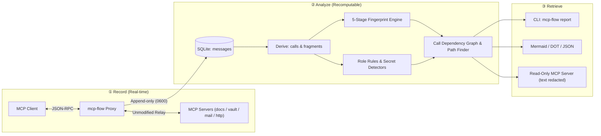
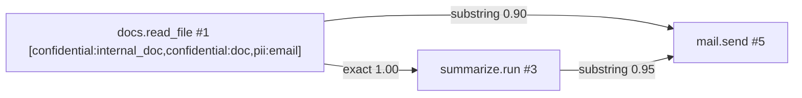

# mcp-flow — MCP Data Flow Tracer

[](https://github.com/stu2230085-maker/mcp-flow/actions/workflows/ci.yml)


[](#license)

[Quick Start](#quick-start) · [CLI Reference](#cli-reference-all-10-subcommands) · [Architecture](#architecture) · [Security Model](#security--privacy-model) · [Design Doc](docs/design.md)

**`mcp-flow`** is a zero-dependency passive data-flow tracer and dependency graph analyzer for the **Model Context Protocol (MCP)**. It sits transparently between an MCP client (such as Claude Desktop, Cursor, or Claude Code) and multiple MCP servers, records raw JSON-RPC 2.0 messages into a local SQLite database (`0600` permissions, WAL mode), and automatically tracks which tool outputs flowed into subsequent tool inputs across servers.

> [!IMPORTANT]
> **Epistemic Disclaimer:** At the protocol boundary, `mcp-flow` observes **content correlation** between tool outputs and subsequent tool inputs—not the internal reasoning of the LLM. Every report, graph, and API response explicitly notes that an edge represents an **observed content match (potential dependency)**, not formal proof of causation.

---

## Table of Contents

- [Why `mcp-flow`?](#why-mcp-flow)
- [Key Features](#key-features)
- [Architecture](#architecture)
- [Installation](#installation)
- [Quick Start](#quick-start)
- [CLI Reference (All 10 Subcommands)](#cli-reference-all-10-subcommands)
  - [Global Options](#global-options)
  - [1. `proxy` — Record `stdio` or Streamable HTTP Traffic](#1-proxy--record-stdio-or-streamable-http-traffic)
  - [2. `analyze` — Recompute Derived Layers & Flows](#2-analyze--recompute-derived-layers--flows)
  - [3. `report` — Detect Hazardous Data-Flow Paths](#3-report--detect-hazardous-data-flow-paths)
  - [4. `graph` — Export Call Dependency Graphs](#4-graph--export-call-dependency-graphs)
  - [5. `label` — Attach Manual Confidentiality Labels](#5-label--attach-manual-confidentiality-labels)
  - [6. `export` — Export Raw Messages (JSONL) or OpenTelemetry Spans](#6-export--export-raw-messages-jsonl-or-opentelemetry-spans)
  - [7. `import` — Import JSONL or `mcptape` Traces](#7-import--import-jsonl-or-mcptape-traces)
  - [8. `serve-mcp` — Read-Only MCP Inspection Server](#8-serve-mcp--read-only-mcp-inspection-server)
  - [9. `evaluate` — Run the Synthetic Benchmark Suite](#9-evaluate--run-the-synthetic-benchmark-suite)
  - [10. `wrap-config` — Auto-Wrap or Unwrap MCP Client Configs](#10-wrap-config--auto-wrap-or-unwrap-mcp-client-configs)
- [Custom Confidentiality Rules & Secret Detectors](#custom-confidentiality-rules--secret-detectors)
- [Security & Privacy Model](#security--privacy-model)
- [Synthetic Benchmark Evaluation](#synthetic-benchmark-evaluation)
- [Development & Testing](#development--testing)
- [License](#license)

---

## Why `mcp-flow`?

When an AI agent connects to multiple MCP servers simultaneously, data returned by one server (internal documents, credentials, database records, PII) can be passed into arguments of another server (`mail.send`, `http.post`, external webhooks) without human visibility. Existing MCP tools focus on single-call recording, latency metrics, or active vulnerability scanning rather than **cross-call, cross-server data-flow lineage**:

| Category | Representative Tools | Primary Capability | How `mcp-flow` Differs |
| :--- | :--- | :--- | :--- |
| **Record & Replay** | `mcptape`, `mcp-recorder`, `mcp-rec`, `agentape` | Record traffic for offline replay and behavioral diffing | Tracks **content flow across calls** rather than just replaying individual requests |
| **Observability Proxies** | `mcpscope` | Inspect requests, latency, and errors per call | Reconstructs **multi-hop data dependency graphs** across servers |
| **OTel Instrumentation** | Elastic / Grafana MCP | Export call spans and metrics from instrumented servers | Works **client-side across unmodified servers** and correlates payload fragments |
| **Security Scanners** | `MCPFuzz`, `MCPFang`, `mcpsec`, `trustmcp` | Active fuzzing, static prompt analysis, attack payloads | **100% passive observation** on real traffic; never injects payloads |
| **Gateways** | Gravitee, Composio | AuthN/AuthZ, audit logging, policy enforcement | Traces **where returned content flowed next**, not just *who called which tool* |

---

## Key Features

### At a Glance

| Pillar | Capability | Highlights |
| :--- | :--- | :--- |
| **Passive Relay** | `stdio` & Streamable HTTP proxy | Zero-mutation JSON-RPC relay, `0600` SQLite WAL log, `--redact-pattern`, `--hash-only` |
| **Recomputable Pipeline** | `messages -> calls -> fragments -> flows` | Append-only primary log; re-run matching & rules anytime via `mcp-flow analyze` |
| **5-Stage Matching** | `exact` → `substring` → `normalized` → `minhash` → `semantic` | Base64/URL/JSON decoding, MinHash shingling, entropy & IDF false-positive suppression |
| **Taint & Path Finding** | Role rules + built-in secret detectors | Detects API keys, JWTs, AWS/GitHub tokens, PEM keys, emails, and confidential markers |
| **3 Output Channels** | CLI, Graph Exports, Read-Only MCP Server | Mermaid, DOT, JSON, JSONL, OTel spans, and `serve-mcp` (redacted by default) |

1. **Zero-Mutation Passive Proxy (`stdio` & `Streamable HTTP`)**:
   - Relays JSON-RPC messages between MCP clients and servers without modifying a single byte or blocking I/O.
   - Appends raw frames to an immutable `messages` log in local SQLite (`0600` owner-only permissions).
   - Supports pre-storage regex redaction (`--redact-pattern`) and hash-only fragment mode (`--hash-only`).
2. **Recomputable Derived Layers (`messages -> calls -> fragments -> flows`)**:
   - Pairs `tools/call` requests and responses into `calls`.
   - Decomposes input arguments (`side='in'`) and output results (`side='out'`) down to leaf strings and embedded JSON fields (`fragments`).
   - Re-runs matching algorithms at any time via `mcp-flow analyze` without re-recording traffic.
3. **5-Stage Cascading Fingerprint Engine**:
   - **Stage 1 (`exact`)**: Raw & basic-normalized SHA-256 hash match (`O(1)` lookup).
   - **Stage 2 (`substring`)**: Contiguous common substring & payload embedding detection with character offset spans.
   - **Stage 3 (`normalized`)**: Multi-pass decoding across Base64 (full & embedded tokens), URL-encoding, JSON escaping, Unicode NFKC, and whitespace stripping.
   - **Stage 4 (`minhash`)**: Character `k`-gram and word shingling with Universal MinHash signatures & Jaccard/containment similarity for edited or reordered text.
   - **Stage 5 (`semantic`, opt-in)**: Pluggable embedding vector cosine similarity (with zero-dependency IDF-weighted hybrid lexical/CJK vector fallback) for heavy paraphrasing.
   - **False-Positive Suppression**: Shannon entropy filters, boolean/literal exclusion, session-wide IDF rarity weighting, and strict temporal ordering (`src_seq < dst_seq`).
4. **Confidentiality Labels & Hazardous Path Detection**:
   - Pattern rules assign `source`, `sink`, and `neutral` roles to servers/tools.
   - Built-in regex detectors automatically tag API keys (`sk-...`), GitHub tokens (`ghp_...`), AWS keys (`AKIA...`), JWTs, Bearer tokens, PEM private keys, email addresses, and confidential document markers.
   - Enumerates all directed paths from labeled sources to external sinks (`mail.send`, `http.post`, etc.) and ranks them by their bottleneck (weakest edge) score.
5. **3 Output Channels**:
   - **CLI Report**: `mcp-flow report <session>`
   - **Graph Exports**: Mermaid (`graph LR`), Graphviz DOT, JSON, and raw JSONL message export.
   - **Read-Only MCP Server**: `mcp-flow serve-mcp` exposes `list_sessions`, `get_flow_graph`, `find_paths`, and `explain_edge` to AI agents while **withholding raw fragment text by default** (returning only hashes, lengths, JSONPaths, and match spans) to prevent re-leaking secrets into the LLM context.

---

## Architecture



---

## Installation

`mcp-flow` requires **Python 3.10+** and uses **only the Python standard library** (`dependencies = []`).

```bash
# Install in editable mode (exposes the `mcp-flow` CLI entry point)
pip install -e .

# Or run directly without installation
PYTHONPATH=src python3 -m mcp_flow --help
```

---

## Quick Start

### 1. Wrap any MCP Server in your Client Configuration

The easiest way to wrap an existing MCP client configuration (such as Claude Desktop or Cursor) is with [`mcp-flow wrap-config`](#10-wrap-config--auto-wrap-or-unwrap-mcp-client-configs), which automatically wraps `mcpServers` entries, writes a `0600` `.bak` backup, and can be reversed anytime with `--unwrap`:

```bash
# Preview changes without modifying disk, then apply
python3 -m mcp_flow wrap-config ~/.config/claude/claude_desktop_config.json --session work-session-01 --db /path/to/mcp_flow.db --dry-run
python3 -m mcp_flow wrap-config ~/.config/claude/claude_desktop_config.json --session work-session-01 --db /path/to/mcp_flow.db
```

> [!TIP]
> Always preview config edits first with `--dry-run`, and restore your original `mcpServers` entries anytime using `--unwrap`. For multi-session workflows, pair `analyze --persist-labels` with `--cross-session` to track sensitive output fingerprints across separate sessions without storing raw text.

<details>
<summary>Alternative: Manual <code>mcpServers</code> JSON configuration (without <code>wrap-config</code>)</summary>

Alternatively, replace your MCP server command manually with `python3 -m mcp_flow proxy` (or `mcp-flow proxy` if installed):

```json
{
  "mcpServers": {
    "docs": {
      "command": "python3",
      "args": [
        "-m", "mcp_flow",
        "--db", "/path/to/mcp_flow.db",
        "proxy",
        "--session", "work-session-01",
        "--server", "docs",
        "--",
        "npx", "-y", "@modelcontextprotocol/server-filesystem", "/corp/docs"
      ]
    },
    "mail": {
      "command": "python3",
      "args": [
        "-m", "mcp_flow",
        "--db", "/path/to/mcp_flow.db",
        "proxy",
        "--session", "work-session-01",
        "--server", "mail",
        "--",
        "python3", "-m", "my_mail_mcp_server"
      ]
    }
  }
}
```

</details>

### 2. Inspect Hazardous Data Flows & Generate Graphs

```bash
# Detect hazardous paths from confidential sources to external sinks
python3 -m mcp_flow --db /path/to/mcp_flow.db report work-session-01

# Export Mermaid dependency graph
python3 -m mcp_flow --db /path/to/mcp_flow.db graph work-session-01 --format mermaid

# Export Graphviz DOT or JSON
python3 -m mcp_flow --db /path/to/mcp_flow.db graph work-session-01 --format dot --out flow.dot

# Run the read-only MCP inspection server (fragment text hidden by default)
python3 -m mcp_flow --db /path/to/mcp_flow.db serve-mcp
```

Example Mermaid output:



---

## CLI Reference (All 10 Subcommands)

```text
mcp-flow [--db DB_PATH] <subcommand> [options]
```

### Global Options

| Option | Default | Description |
| :--- | :--- | :--- |
| `--db PATH` | `mcp_flow.db` | Path to the local SQLite database file (created with `0600` permissions). |

---

### 1. `proxy` — Record `stdio` or Streamable HTTP Traffic

Transparently forwards JSON-RPC 2.0 traffic between an MCP client and an upstream MCP server while recording raw frames into the `messages` table.

| Option | Default | Description |
| :--- | :--- | :--- |
| `--session ID` | *(required)* | Session identifier to group messages across multiple servers. |
| `--server NAME` | *(required)* | Logical MCP server name (e.g., `docs`, `vault`, `mail`, `http`). |
| `--transport {stdio,http}` | `stdio` | Transport mode (`stdio` child process or `http` reverse proxy). |
| `--target-url URL` | `None` | Upstream server endpoint URL (required when `--transport http`). |
| `--port PORT` | `8765` | Local listen port when `--transport http`. |
| `--hash-only` | `False` | Omit raw fragment text during derivation, storing only SHA-256 hashes and lengths. |
| `--redact-pattern REGEX` | `[]` | Regex pattern to redact with `[REDACTED:PATTERN_<N>]` before writing to SQLite (repeatable). |
| `-- <command...>` | — | Target MCP server command and arguments (required when `--transport stdio`). |

**Examples:**

```bash
# stdio proxy with pre-storage regex redaction
mcp-flow --db trace.db proxy \
  --session sess-01 \
  --server vault \
  --redact-pattern "sk-[A-Za-z0-9]{20,}" \
  -- python3 -m my_vault_server

# Streamable HTTP proxy listening on localhost:8765
mcp-flow --db trace.db proxy \
  --session sess-01 \
  --server remote-api \
  --transport http \
  --target-url http://127.0.0.1:9000/mcp \
  --port 8765
```

---

### 2. `analyze` — Recompute Derived Layers & Flows

Clears and recomputes all derived tables (`calls`, `fragments`, `flows`, and rule-based `labels`) from the immutable `messages` log. Use this to experiment with different matching stages, score thresholds, or custom rule files on an existing recording.

| Argument / Option | Default | Description |
| :--- | :--- | :--- |
| `session` | *(required)* | Target session ID to analyze. |
| `--max-stage {1,2,3,4,5}` | `4` | Highest fingerprint matching stage to execute (`1`=exact, `2`=substring, `3`=normalized, `4`=minhash, `5`=semantic). |
| `--enable-semantic` | `False` | Explicitly opt in to Stage 5 semantic similarity matching. |
| `--min-score FLOAT` | `0.35` | Minimum confidence score (`0.0`–`1.0`) required to record a candidate flow edge. |
| `--rules PATH` | `None` | Path to a custom JSON rules file defining tool roles and confidentiality labels. |
| `--persist-labels` | `False` | Record hash-only fingerprints of sensitive output fragments for cross-session tracking. |
| `--cross-session` | `False` | Match input fragments against persistent fingerprints from earlier sessions. |

**Example:**

```bash
# Re-analyze a session up to Stage 5 (semantic) with custom tool role rules and cross-session tracking
mcp-flow --db trace.db analyze sess-01 --max-stage 5 --enable-semantic --rules my_rules.json --persist-labels --cross-session
```

---

### 3. `report` — Detect Hazardous Data-Flow Paths

Builds the session's call-level dependency graph and enumerates directed paths from confidential sources to external sink tools, ranked by bottleneck edge score. Automatically runs `analyze` if derived tables have not been populated yet.

| Argument / Option | Default | Description |
| :--- | :--- | :--- |
| `session` | *(required)* | Target session ID to report on. |
| `--source-label PATTERN` | `*` | Glob pattern filtering source confidentiality labels (e.g., `secret:*`, `confidential:*`, `pii:*`). |
| `--sink-role ROLE` | `sink` | Target tool role considered an exfiltration sink. |
| `--min-score FLOAT` | `0.35` | Minimum edge confidence score threshold. |
| `--format {text,json}` | `text` | Output format (`text` human-readable report or structured `json`). |
| `--expose-text` | `False` | Include raw fragment text snippets in the output (omitted by default for safety). |
| `--recompute` | `False` | Force full recomputation of derived data before generating the report. |
| `--cross-session` | `False` | Enable cross-session taint matching when recomputing or matching against prior persistent fingerprints. |

**Example:**

```bash
# Report only paths originating from secret:* labels with score >= 0.50 in JSON format
mcp-flow --db trace.db report sess-01 --source-label "secret:*" --min-score 0.50 --format json
```

---

### 4. `graph` — Export Call Dependency Graphs

Exports the call-level data dependency graph for visualization or downstream tooling.

| Argument / Option | Default | Description |
| :--- | :--- | :--- |
| `session` | *(required)* | Target session ID. |
| `--format {mermaid,dot,json}` | `mermaid` | Graph output format (`mermaid`, Graphviz `dot`, or `json`). |
| `--min-score FLOAT` | `0.35` | Minimum edge score to include in the exported graph. |
| `--expose-text` | `False` | Include raw fragment text in JSON output. |
| `--out PATH` | `stdout` | Write output to a file path instead of standard output. |

**Example:**

```bash
mcp-flow --db trace.db graph sess-01 --format mermaid --out sess-01.mmd
```

---

### 5. `label` — Attach Manual Confidentiality Labels

Manually tags a specific tool call or fragment with a confidentiality label (persisted with `source='manual'`, which survives `analyze` recomputations).

| Option | Default | Description |
| :--- | :--- | :--- |
| `--target-kind {call,fragment}` | `call` | Entity type to label (`call` or `fragment`). |
| `--target-id INT` | *(required)* | Numeric primary key ID of the target call or fragment. |
| `--label LABEL` | *(required)* | Confidentiality label string to attach (e.g., `confidential:board_memo`). |

**Example:**

```bash
mcp-flow --db trace.db label --target-kind call --target-id 1 --label "confidential:exec_roadmap"
```

---

### 6. `export` — Export Raw Messages (JSONL) or OpenTelemetry Spans

Exports all recorded raw JSON-RPC messages for a session as newline-delimited JSON (`jsonl`), or exports derived tool calls and flow dependencies as OpenTelemetry Span JSON (`otel`) for external observability tooling.

| Argument / Option | Default | Description |
| :--- | :--- | :--- |
| `session` | *(required)* | Target session ID to export. |
| `--format {jsonl,otel}` | `jsonl` | Output format (`jsonl` raw messages or `otel` OpenTelemetry Span JSON). |
| `--out PATH` | `stdout` | Output file path (prints to `stdout` if omitted). |

**Examples:**

```bash
# Export immutable raw JSON-RPC messages as JSONL
mcp-flow --db trace.db export sess-01 --format jsonl --out sess-01-messages.jsonl

# Export derived calls and flows as OpenTelemetry Span JSON
mcp-flow --db trace.db export sess-01 --format otel --out sess-01-otel.json
```

---

### 7. `import` — Import JSONL or `mcptape` Traces

Imports `mcp-flow` JSONL exports or `mcptape`-compatible JSONL trace recordings into the local `messages` table for offline flow analysis.

| Argument / Option | Default | Description |
| :--- | :--- | :--- |
| `jsonl_file` | *(required)* | Path to the JSONL trace file to import. |
| `--session ID` | `None` | Override the session ID for imported messages (uses the trace's session ID or generates one when omitted). |

**Example:**

```bash
mcp-flow --db trace.db import recordings/sample.jsonl --session imported-sess-01
```

---

### 8. `serve-mcp` — Read-Only MCP Inspection Server

Runs a read-only MCP server over `stdio` so an AI agent or MCP client can inspect its own session's data-flow lineage.

| Option | Default | Description |
| :--- | :--- | :--- |
| `--expose-text` | `False` | Explicitly allow returning raw fragment text in MCP tool responses (disabled by default to avoid re-injecting secrets into the LLM context). |

**Exposed MCP Tools:**
- `list_sessions()`: List recorded sessions with message and tool call counts.
- `get_flow_graph(session_id, min_score=0.35)`: Return the call-level data dependency graph.
- `find_paths(session_id, source_label="*", sink_role="sink", min_score=0.35)`: Find hazardous paths from labeled sources to sinks.
- `explain_edge(session_id, edge_id)`: Return fragment-level match evidence (hashes, lengths, JSONPaths, character spans, and scores) for an edge such as `"e:1->2"`.

---

### 9. `evaluate` — Run the Synthetic Benchmark Suite

Runs the built-in deterministic evaluation suite across all 5 fingerprint stages and prints Precision, Recall, F1, True/False Positives, and Negative Scenario False Positives.

| Option | Default | Description |
| :--- | :--- | :--- |
| `--format {text,json}` | `text` | Output format (`text` markdown table or `json`). |

**Example:**

```bash
mcp-flow evaluate --format text
```

---

### 10. `wrap-config` — Auto-Wrap or Unwrap MCP Client Configs

Automatically wraps `mcpServers` entries in an MCP client JSON configuration file with `python3 -m mcp_flow proxy` (or restores original commands with `--unwrap`). Creates an atomic `0600` `.bak` backup before modifying the target configuration file.

| Argument / Option | Default | Description |
| :--- | :--- | :--- |
| `config_json_path` | *(required)* | Path to the MCP client JSON configuration file. |
| `--session ID` | *(generated)* | Session ID embedded in wrapped proxy commands (a UUID hex string is generated when omitted). |
| `--db PATH` | `mcp_flow.db` | Local SQLite database path embedded in wrapped commands (inherits global `--db` if omitted). |
| `--servers LIST` | `None` | Comma-separated list of MCP server names to target (targets all servers in `mcpServers` when omitted). |
| `--unwrap` | `False` | Restore original server commands by removing generated `mcp-flow proxy` wrappers. |
| `--dry-run` | `False` | Print the transformed JSON to `stdout` without writing files or backups. |

**Examples:**

```bash
# Preview wrapped config without modifying disk
mcp-flow wrap-config claude_desktop_config.json --session sess-01 --db /path/to/mcp_flow.db --dry-run

# Wrap only specific servers (creates claude_desktop_config.json.bak with 0600 permissions)
mcp-flow wrap-config claude_desktop_config.json --session sess-01 --servers docs,mail

# Restore original server commands
mcp-flow wrap-config claude_desktop_config.json --unwrap
```

---

## Custom Confidentiality Rules & Secret Detectors

During `analyze`, `mcp-flow` assigns a role (`source`, `sink`, or `neutral`) and confidentiality labels to every tool call using pattern rules, and scans fragment content using built-in regex secret detectors.

### Custom Rules JSON Format (`--rules`)

Pass a JSON file to `mcp-flow analyze <session> --rules custom_rules.json`:

```json
{
  "include_defaults": true,
  "rules": [
    {
      "server": "crm*",
      "tool": "*customer*",
      "role": "source",
      "labels": ["confidential:crm", "pii:customer_record"]
    },
    {
      "server": "discord*",
      "tool": "*send*",
      "role": "sink",
      "labels": []
    }
  ]
}
```

- `server` / `tool`: Case-insensitive glob patterns (`fnmatch`).
- `role`: `"source"`, `"sink"`, or `"neutral"`.
- `labels`: List of labels automatically attached to matching tool calls.
- `include_defaults`: When `true` (default), appends the built-in rules (`vault*`, `docs*`, `fs*`, `db*` as sources; `mail*`, `http*`, `webhook*`, `slack*` as sinks).

### Built-In Content Detectors

Regardless of tool names, `mcp-flow` inspects fragment strings for sensitive content patterns and propagates detected labels to originating tool calls:
- `secret:api_key` (`sk-...`)
- `secret:github_token` (`ghp_...`, `github_pat_...`)
- `secret:aws_key` (`AKIA...`, `ASIA...`)
- `secret:jwt` (3-part Base64URL JWT tokens)
- `secret:bearer_token` (`Bearer ...`)
- `secret:private_key` (`-----BEGIN ... PRIVATE KEY-----`)
- `pii:email` (RFC-style email addresses)
- `confidential:doc` (`CONFIDENTIAL`, `INTERNAL_ONLY`, `SECRET_TOKEN`, `社外秘`, `機密文書`, `極秘`)

---

## Security & Privacy Model

- **Passive Observation Only**: `mcp-flow` never alters relayed packets, blocks traffic, or injects scanning payloads.
- **Local-Only & `0600` Permissions**: All trace data resides strictly in a local SQLite file enforced with `0600` (`rw-------`) owner-only file permissions. No telemetry or external network requests are ever made.
- **Pre-Storage Redaction & Hash-Only Mode**: Sensitive patterns can be scrubbed before hitting disk (`--redact-pattern`), or raw text can be discarded during fragment derivation (`--hash-only`) while still permitting Stage 1 exact hash matching.
- **Default Non-Disclosure in `serve-mcp`**: The read-only MCP server never returns raw fragment text unless `--expose-text` is explicitly passed, preventing sensitive payloads from being re-exposed to the LLM context window during self-inspection.

> [!NOTE]
> Keeping `expose_text=False` (the default in `serve-mcp`) ensures an AI agent auditing its own trace only sees structural metadata—SHA-256 hashes, byte lengths, JSONPaths, character offset spans, and confidence scores—eliminating the risk of secret re-injection into the LLM context window.

---

## Synthetic Benchmark Evaluation

Run the built-in LLM-free synthetic evaluation suite covering exact copy, substring embedding, Base64/URL-encoded exfiltration, clause reordering, heavy paraphrasing, and unrelated negative scenarios:

```bash
PYTHONPATH=src:. python3 -m mcp_flow evaluate
```

| Configuration | Precision | Recall | F1 | TP | FP | FN | Negative FP |
| :--- | :---: | :---: | :---: | :---: | :---: | :---: | :---: |
| Stage 1 (Exact) | 1.00 | 0.25 | 0.40 | 2 | 0 | 6 | 0 |
| Stage 1-2 (+Substring) | 1.00 | 0.50 | 0.67 | 4 | 0 | 4 | 0 |
| Stage 1-3 (+Normalized/Base64/URL) | 1.00 | 0.75 | 0.86 | 6 | 0 | 2 | 0 |
| Stage 1-4 (+MinHash Shingles) | 1.00 | 0.88 | 0.93 | 7 | 0 | 1 | 0 |
| Stage 1-5 (+Semantic Opt-in) | 1.00 | 1.00 | 1.00 | 8 | 0 | 0 | 0 |

---

## Development & Testing

See [docs/design.md](docs/design.md) for the architectural design document and [AGENTS.md](AGENTS.md) for multi-agent collaboration and architectural invariants.

Run the mandatory verification gates before opening a Pull Request:

```bash
# 1. Full unit and integration test suite (zero external dependencies)
PYTHONPATH=src:. python3 -m unittest discover -s tests -v

# 2. Synthetic evaluation harness (must maintain Negative FP == 0)
PYTHONPATH=src:. python3 -m mcp_flow evaluate
```

---

## License

MIT License
