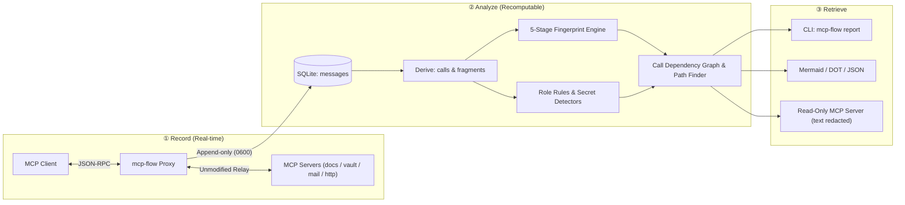

# mcp-flow — MCP Data Flow Tracer

**`mcp-flow`** is a zero-dependency passive data-flow tracer and dependency graph analyzer for the **Model Context Protocol (MCP)**. It sits transparently between an MCP client (such as Claude Desktop, Cursor, or Claude Code) and multiple MCP servers, records raw JSON-RPC 2.0 messages into a local SQLite database (`0600` permissions, WAL mode), and automatically tracks which tool outputs flowed into subsequent tool inputs across servers.

> **Important Epistemic Disclaimer**  
> At the protocol boundary, `mcp-flow` observes **content correlation** between tool outputs and subsequent tool inputs—not the internal reasoning of the LLM. Every report, graph, and API response explicitly notes that an edge represents an **observed content match (potential dependency)**, not formal proof of causation.

---

## Key Features

1. **Zero-Mutation Passive Proxy (`stdio` & `Streamable HTTP`)**:
   - Relays JSON-RPC messages between MCP clients and servers without modifying a single byte or blocking I/O.
   - Appends raw frames to an immutable `messages` log in local SQLite (`0600` owner-only permissions).
   - Supports pre-storage regex redaction (`--redact-pattern`) and hash-only fragment mode (`--hash-only`).
2. **Recomputable Derived Layers (`messages -> calls -> fragments -> flows`)**:
   - Pairs `tools/call` requests and responses into `calls`.
   - Decomposes input arguments (`side='in'`) and output results (`side='out'`) down to leaf strings and embedded JSON fields (`fragments`).
   - Re-runs matching algorithms at any time without re-recording traffic.
3. **5-Stage Cascading Fingerprint Engine**:
   - **Stage 1 (`exact`)**: Raw & basic-normalized SHA-256 hash match ($O(1)$ lookup).
   - **Stage 2 (`substring`)**: Contiguous common substring & payload embedding detection with character offset spans.
   - **Stage 3 (`normalized`)**: Multi-pass decoding across Base64 (full & embedded tokens), URL-encoding, JSON escaping, Unicode NFKC, and whitespace stripping.
   - **Stage 4 (`minhash`)**: Character $k$-gram and word shingling with Universal MinHash signatures & Jaccard/containment similarity for edited or reordered text.
   - **Stage 5 (`semantic`, opt-in)**: Pluggable embedding vector cosine similarity (with zero-dependency IDF-weighted hybrid lexical/CJK vector fallback) for heavy paraphrasing.
   - **False-Positive Suppression**: Shannon entropy filters, boolean/literal exclusion, session-wide IDF rarity weighting, and strict temporal ordering (`src_seq < dst_seq`).
4. **Confidentiality Labels & Hazardous Path Detection**:
   - Pattern rules assign `source`, `sink`, and `neutral` roles to servers/tools.
   - Built-in regex detectors automatically tag API keys (`sk-...`), GitHub tokens (`ghp_...`), AWS keys (`AKIA...`), JWTs, Bearer tokens, PEM private keys, email addresses, and confidential document markers.
   - Enumerates all directed paths from labeled sources to external sinks (`mail.send`, `http.post`, etc.) and ranks them by their bottleneck (weakest edge) score.
5. **3 Output Channels**:
   - **CLI Report**: `mcp-flow report <session>`
   - **Graph Exports**: Mermaid (`graph LR`), Graphviz DOT, JSON, and raw JSONL message export.
   - **Read-Only MCP Server**: `mcp-flow serve-mcp` exposes `list_sessions`, `get_flow_graph`, `find_paths`, and `explain_edge` to AI agents while **withholding raw fragment text by default** (returning only hashes, lengths, JSONPaths, and match spans) to prevent re-leaking secrets into the LLM context.

---

## Architecture



---

## Quick Start

### 1. Wrap any MCP Server in your Client Configuration

Replace your MCP server command with `python3 -m mcp_flow proxy`:

```json
{
  "mcpServers": {
    "docs": {
      "command": "python3",
      "args": ["-m", "mcp_flow", "--db", "/path/to/mcp_flow.db", "proxy", "--session", "work-session-01", "--server", "docs", "--", "npx", "-y", "@modelcontextprotocol/server-filesystem", "/corp/docs"]
    },
    "mail": {
      "command": "python3",
      "args": ["-m", "mcp_flow", "--db", "/path/to/mcp_flow.db", "proxy", "--session", "work-session-01", "--server", "mail", "--", "python3", "-m", "my_mail_mcp_server"]
    }
  }
}
```

### 2. Inspect Hazardous Data Flows & Generate Graphs

```bash
# Detect hazardous paths from confidential sources to external sinks
python3 -m mcp_flow --db /path/to/mcp_flow.db report work-session-01

# Export Mermaid dependency graph
python3 -m mcp_flow --db /path/to/mcp_flow.db graph work-session-01 --format mermaid

# Export Graphviz DOT or JSON
python3 -m mcp_flow --db /path/to/mcp_flow.db graph work-session-01 --format dot --out flow.dot

# Run the read-only MCP inspection server (fragment text hidden by default)
python3 -m mcp_flow --db /path/to/mcp_flow.db serve-mcp
```

Example Mermaid output:


---

## Synthetic Benchmark Evaluation

Run the built-in LLM-free synthetic evaluation suite covering exact copy, substring embedding, Base64/URL-encoded exfiltration, clause reordering, heavy paraphrasing, and unrelated negative scenarios:

```bash
PYTHONPATH=src python3 -m mcp_flow evaluate
```

| Configuration | Precision | Recall | F1 | TP | FP | FN | Negative FP |
| :--- | :---: | :---: | :---: | :---: | :---: | :---: | :---: |
| Stage 1 (Exact) | 1.00 | 0.25 | 0.40 | 2 | 0 | 6 | 0 |
| Stage 1-2 (+Substring) | 1.00 | 0.50 | 0.67 | 4 | 0 | 4 | 0 |
| Stage 1-3 (+Normalized/Base64/URL) | 1.00 | 0.75 | 0.86 | 6 | 0 | 2 | 0 |
| Stage 1-4 (+MinHash Shingles) | 1.00 | 0.88 | 0.93 | 7 | 0 | 1 | 0 |
| Stage 1-5 (+Semantic Opt-in) | 1.00 | 1.00 | 1.00 | 8 | 0 | 0 | 0 |

---

## Running Tests

```bash
PYTHONPATH=src python3 -m unittest discover -s tests -v
```

---

## License

MIT License
